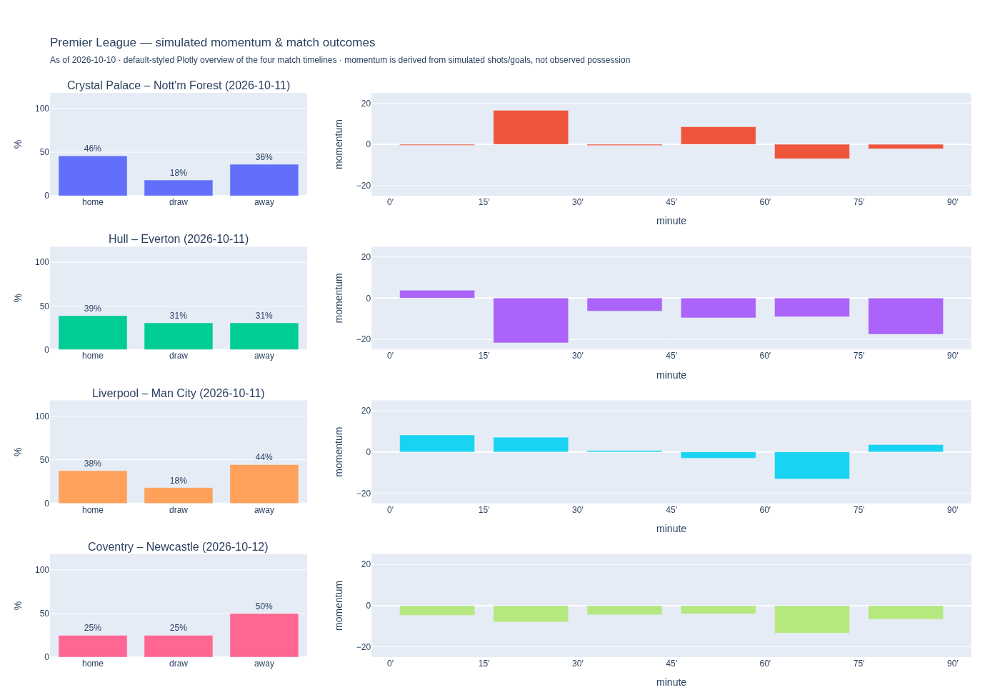
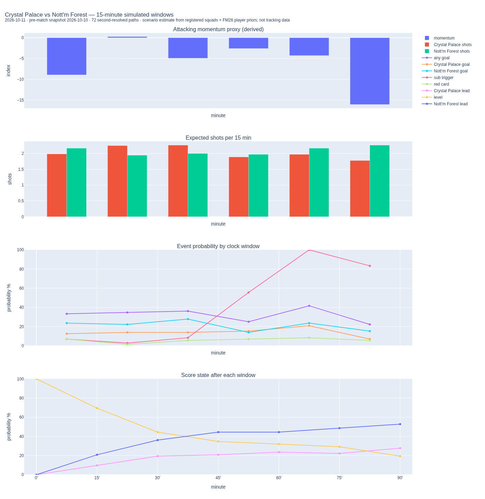
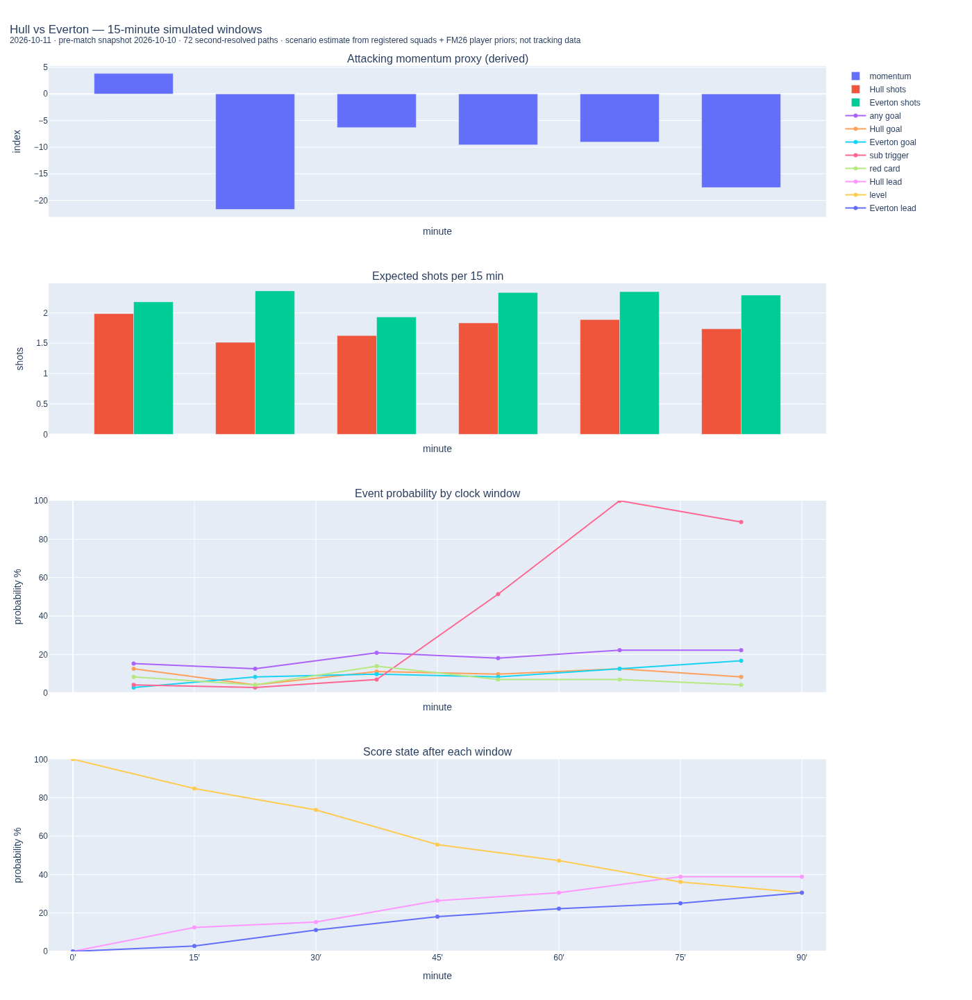
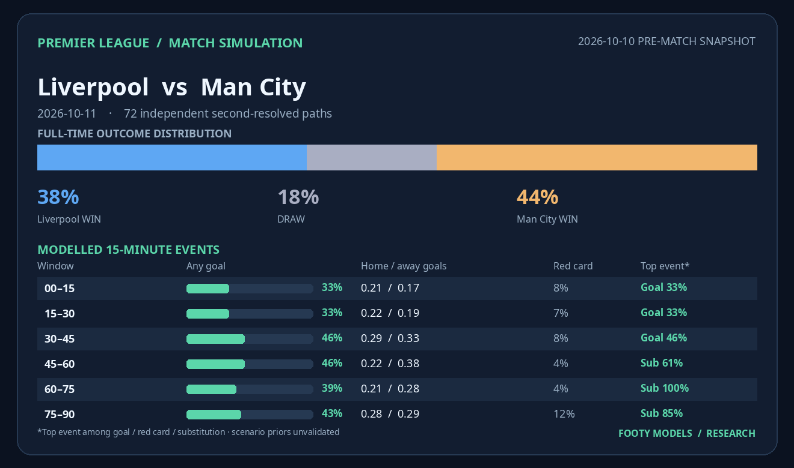
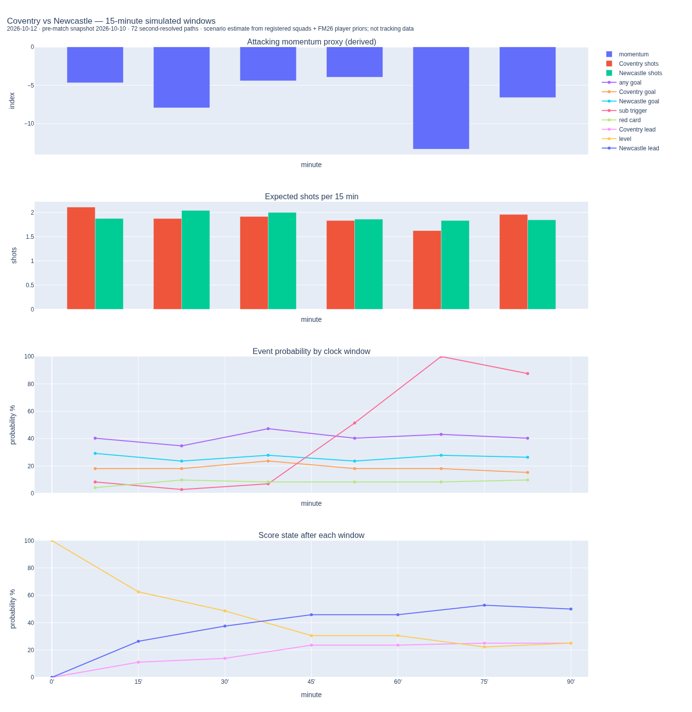
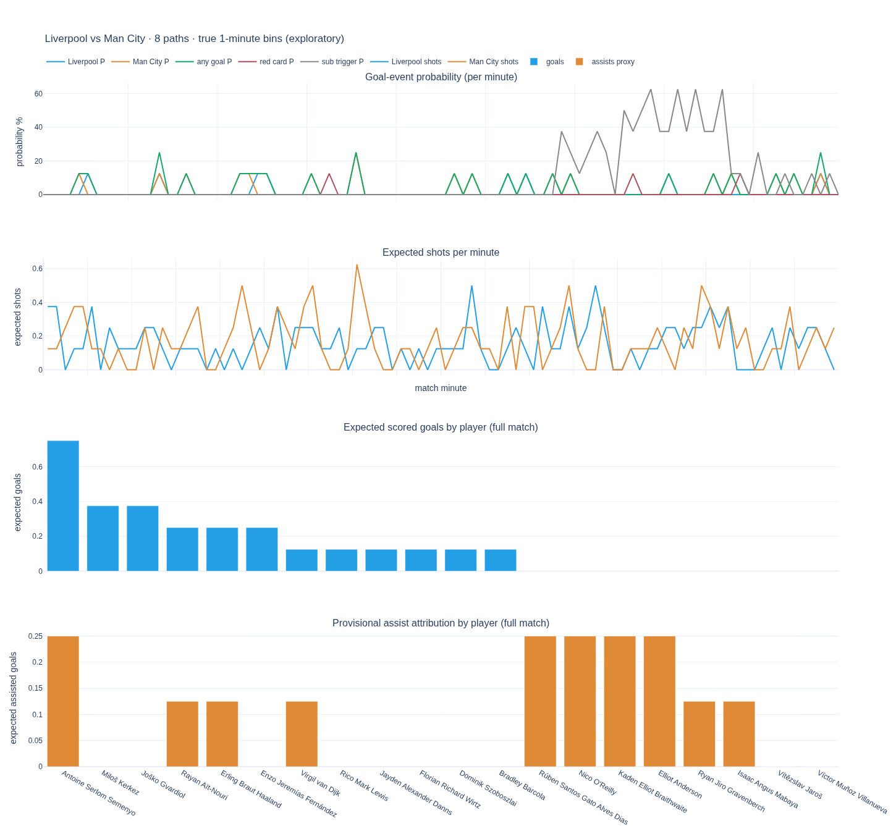
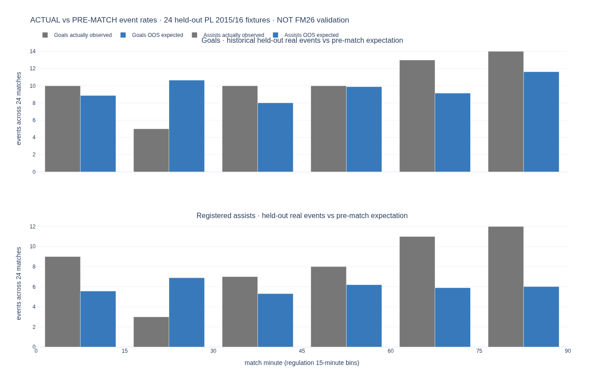

# Footy Models

Player-focused football modeling in Rust: FM26 attributes, historical player/team performance, lineup uncertainty, contextual interactions, a state-dependent one-second match simulator, and reproducible match forecasts.

**Next engine architecture:** [FM24-informed full match engine — reconstruction and implementation plan](docs/fm24-engine-reconstruction.md). This approved direction replaces direct goal hazards **in a future challenger** with action-driven, FM-style Rust match simulation, full-trajectory Monte Carlo, and correlated rare-event paths. The currently published simulator and independently validated forecasting models remain unchanged until an explicit migration.

## Premier League — 11–12 October 2026

**Player-driven match timelines: 15-minute attacking momentum, expected shots, event probabilities, and evolving score state.**



The simulation excludes players explicitly reported injured or suspended in the [October 9 team-news snapshot](https://www.theguardian.com/football/2026/oct/09/premier-league-team-news-predicted-lineups-for-the-weekend-action); doubtful players remain in the stochastic lineup pool.

After matching 391 FM26 records across the eight official registered squads, the simulated eligible pools retain **323 players** once loaned-out registrations and confirmed injuries/suspensions are excluded. This snapshot uses the existing **[`simulate_second_resolved_dynamic_mental_match`](crates/match/src/second_resolved_api.rs)** engine with FM26 players matched to [2026–27 registered Premier League squads](https://www.premierleague.com/en/news/4706139/see-all-the-202627-premier-league-squad-lists). Each fixture simulates a full 90-minute game with six observed-in-simulation 15-minute event windows, randomized lineups, goals, substitutions, red cards and changing player mental state.

The charts show **four aligned time-series panels** for each simulated 90-minute match: (1) attacking momentum derived from modeled shots and goals (positive bars = home pressure, negative bars = away pressure), (2) projected shot volume per 15 minutes, (3) probability of modeled goals, red cards and substitution triggers in each interval, and (4) the chance of each team leading or a level score at the end of each interval. **They are simulated scenarios, not live match-event data.** Open the SVG for lossless zoom, or the matching Plotly HTML locally for event-probability tooltips and trace toggles (the HTML loads Plotly.js from a CDN).

### Match timelines

**Crystal Palace vs Nottingham Forest**



[Vector SVG](assets/predictions/2026-10-11/01-crystal-palace.svg) · [Interactive HTML](assets/predictions/2026-10-11/01-crystal-palace.html)

**Hull vs Everton**



[Vector SVG](assets/predictions/2026-10-11/02-hull.svg) · [Interactive HTML](assets/predictions/2026-10-11/02-hull.html)

**Liverpool vs Manchester City**



[Vector SVG](assets/predictions/2026-10-11/03-liverpool.svg) · [Interactive HTML](assets/predictions/2026-10-11/03-liverpool.html)

**Coventry vs Newcastle**



[Vector SVG](assets/predictions/2026-10-11/04-coventry.svg) · [Interactive HTML](assets/predictions/2026-10-11/04-coventry.html)

The snapshots, including every 15-minute probability, team/player forecast and provenance details, are stored in [`artifacts/premier-league-2026-10-11`](artifacts/premier-league-2026-10-11). A [readable window-by-window table](docs/premier-league-player-forecasts-2026-10-11.md) lists each event probability. The [independent, historically fitted results + FM benchmark](docs/premier-league-forecast-2026-10-11.md) is preserved separately rather than passed off as player-resolved simulation.

**Player-level validation update:** The engine now has a separate 90-bin-per-match output for player-attributed shots and goals, provisional assister allocations, and minute events. See the [real historical held-out event audit](docs/premier-league-player-event-oos-validation.md). On 24 actual Premier League 2015–16 event matches, historical player/team event-rate baselines **failed to establish improvement** for goal and assist timing; this does **not** validate the 2026 FM26 engine. The original 72-path October snapshot does not contain native per-minute player events: those require an explicit rerun, never guessed interpolation.

### Native one-minute player forecasts — diagnostic only

The upgraded engine now produces **90 actual simulation-minute windows**, and per-player shot and scorer totals. The first four-fixture integration run below uses **only eight independent paths per match** to test instrumentation. **It is not a statistically meaningful forecast and must not replace the frozen 72-path results above.** Assist values are provisional conditional assignments using an unvalidated assisted-goal prior, **not measured assists or expected assists fitted from Premier League data**.



[Palace–Forest diagnostic](assets/validation/pl-minute-sample-8paths/01-crystal-palace.html) · [Hull–Everton diagnostic](assets/validation/pl-minute-sample-8paths/02-hull.html) · [Liverpool–City diagnostic](assets/validation/pl-minute-sample-8paths/03-liverpool.html) · [Coventry–Newcastle diagnostic](assets/validation/pl-minute-sample-8paths/04-coventry.html). Each includes a matching player-goals/shots/assist-credit CSV generated by [`render_pl_player_minute.py`](scripts/render_pl_player_minute.py).

### Held-out real Premier League validation



The [24-match historical player-event OOS audit](docs/premier-league-player-event-oos-validation.md) compares genuinely observed goals, assists and minute windows to a **separately trained, strictly chronological historical-rate baseline**. Goal and assist timing forecasts do **not** outperform simple previous-only references. This **does not yet validate the current FM26 player simulator**. It shows exactly what still needs calibration and preserves the evaluation code for an as-of historical model backtest.

### Same-engine historical backtest (observed-stat-only contract)

The [same-engine walk-forward backtest](docs/historical-same-engine-backtest.md) runs the **actual Rust second-resolved engine** on the cached 2015/16 StatsBomb subset with a strictly causal observed-stat-only input contract (no FM26 attributes, no current squads, no future information), scores held-out fixtures against causal Poisson and previous-only player/timing baselines with matchday-block bootstrap intervals, and records the engine fingerprint in [`artifacts/validation/pl-hist-same-engine-oos.json`](artifacts/validation/pl-hist-same-engine-oos.json). This is the first genuinely same-engine OOS evidence in the repository; it validates (or fails to validate) the **engine on historical inputs**, and explicitly does **not** validate the FM26-enhanced 2026 pipeline.

On 25 held-out fixtures (2016-02-13 → 2016-05-17): player **goal occurrence**, player **shot volume**, **one-minute goal occurrence** and substitution incidence beat their causal references with 95% bootstrap intervals below zero. Match **W/D/L**, **exact score** and **team-goal** distributions do **not** beat the causal regularized-Poisson baseline (exact score is clearly worse), and the lineup sampler's **start/appearance** marginals are clearly worse than its own input prior. The 25-fixture, two-club-dominated sample is far below the 200-fixture release threshold, so every target remains `research_only` regardless of outcome. Two frozen calibration experiments are recorded in the same document: a global fit-period goal/home correction was **rejected** (W/D/L and 15-minute losses significantly worse OOS; the fit-period overprediction did not persist), while a fit-period selection-marginal correction reduced the lineup-sampler compression and improved player minutes MAE, and is retained as an explicit, non-default research flag.

**Interpretation:** The player-simulation results are **experimental scenario estimates**, not independently validated Premier League betting probabilities. The registered squad source is not a starting XI: some players' 2026–27 minutes, injuries and suspensions are unavailable. FM26 attributes and prior-season exposure supply labeled uncertain proxies for player event rates and selection. The first player-resolved engine has weak historical MLS holdout calibration (see [`BACKTEST_RESULTS_MLS.md`](BACKTEST_RESULTS_MLS.md)); with 72 paths, the binomial Monte Carlo standard error can reach 5.9 percentage points (approximately ±12 points at 95% confidence) even before model uncertainty. More Monte Carlo paths improve random sampling precision, not predictive validity. The reported 15-minute goal/red-card/substitution probabilities are event summaries from the same stateful simulated paths, not independent post-hoc Poisson draws.

**2026-10-11 research additions:** [Causal FM/player, team-strength, Polymarket and mathematical-model audit](docs/forecast-research-and-market-2026-10-11.md). The historical CSV importer recovers 11,113 EPL fixtures; its sealed 1,270-fixture incident benchmark supports a substantially lower red-card prior but does not yet validate full match outcomes. The historical Rust driver also offers a non-default team-specific goal anchor, while verified pre-kickoff Polymarket odds can be added as an **independent sidecar comparator**, never retroactively pasted into coherent simulated paths.

**Liverpool–City timing case study:** The saved October 10 relative-pressure forecast singled out the 60–75 minute window, coinciding with Liverpool's real 62' red card and City's 65'/68' goals; the third goal came at 78'. The [audited match and historical momentum study](docs/liverpool-city-momentum-case-2026-10-11.md) distinguishes this intriguing alignment from absolute goal-rate forecasting. On 25 earlier-season held-out matches, the engine has only marginal, statistically unresolved advantage over constant pressure and uniform goal timing. An apparent same-seed replay difference is tied to unverified binary/input equivalence, not evidence of nondeterministic simulation. Every evaluated result is preserved with provenance and no production promotion.

**Frozen experiment/ablation update:** A [binary- and input-hash-frozen research runner](scripts/run_frozen_pl_research.py) now verifies byte-identical repeated forecasts, and the [Liverpool mechanism audit](docs/liverpool-mechanism-ablation-2026-10-11.md) compares opt-in suppression of scheduled tactical substitutions and red-card hazards. The observed pressure peak changes in 12-path experiments, **which are too small and RNG-uncoupled to identify causal effects**. The production match-simulation defaults remain unchanged. A separate, historically validated numerical-advantage and substitution-timing model remains future work.

**Timing evidence corrected:** A [raw StatsBomb elapsed-clock reassessment](docs/historical-elapsed-clock-reassessment-2026-10-11.md) found an inherited one-minute label offset that can mis-bin halftime events. On exactly the same 25 held-out fixtures, correcting time alignment removes the previously reported tiny improvement over uniform goal timing (corrected engine 1.79482 versus uniform 1.79176 negative log loss per goal). The simulator's substitution-trigger incidence also fails to beat an earlier-fit completed-substitution timing reference, though the event definitions differ. Prior reports are preserved with a clearly labeled v2 correction; do not tune from these already-examined outcomes.

**Starting XI research challenger:** An [opt-in exact-cardinality maximum-entropy subset sampler](docs/lineup-exact-cardinality-research-2026-10-11.md) projects inconsistent pre-match start priors onto the exactly-eleven constraint, then uses an `O(n × 11)` log-partition dynamic program for each lineup draw. The original role-sensitive sequential sampler is still the production default. The alternative is restricted to role-neutral historical inputs, and preserving selection marginals conditional on availability is not an unconditional calibration claim.

**Versioned label and substitution output contracts:** The corrected StatsBomb v2 materializer preserves all 75 pre-match feature files byte-for-byte and retains source elapsed minute/second/period for events, with a [machine-audited migration](artifacts/validation/pl-hist-label-clock-v2-audit.json). The Rust engine now provides a separate `p_completed_substitution` metric for actual lineup replacements while retaining the legacy attempted-event probability for compatibility. Neither change retunes the goal engine or alters original archived forecasts.

**Rust Candle/FBref research:** The [FM26 Candle/MLS experiment](docs/fm26-candle-mls-shots-2026-10-11.md) now includes a permutation-equivariant masked player-set transformer, strictly prior-appearance candidate sets, a matched ridge-Poisson challenger and a fail-closed offline or explicitly opt-in [FBref/soccerdata importer](scripts/import_fbref_soccerdata.py). July validation did **not** favor the neural or ridge corrections, so the causal player-event-rate reference remains unchanged.

### Reproduce — one command

The full pipeline is saved in [`scripts/run_pl_pipeline.py`](scripts/run_pl_pipeline.py). It runs match-data refitting, official squad → FM26 UID matching, injury and loan exclusions, the **original stateful second-resolved engine**, validation, timelines, and a source-audited report:

```bash
# Recreate PNG/SVG match timelines from the committed simulation JSON;
# no raw source datasets, FM database, refit, or Monte Carlo computation needed:
python3 scripts/run_pl_pipeline.py --render-only

# Regenerate the entire matchweek from local historical CSVs and FM26 input:
python3 scripts/run_pl_pipeline.py --offline --paths 72 --seed 42 \
  --fixtures configs/pl_2026-10-11.json \
  --availability configs/pl_availability_2026-10-11.json \
  --fm-file /path/to/fm26_men_full_attrs.csv

# See exactly what commands the full pipeline would run without changing files:
python3 scripts/run_pl_pipeline.py --dry-run --offline \
  --fm-file /path/to/fm26_men_full_attrs.csv
```

[Full data pipeline documentation](docs/premier-league-pipeline.md) · [Machine-readable 15-minute event and momentum data](assets/predictions/2026-10-11/momentum_15min.json) · [All forecast script inventory](docs/game-forecasting-inventory.md). Python's `requests` and `beautifulsoup4` are used for roster retrieval; `plotly` creates interactive HTML timelines, and `kaleido` with Chromium exports matching PNG/SVG static figures. Raw licensed player data and fetched source datasets stay out of Git.

## Forecast targets and accuracy gates

The [versioned target contract](configs/forecast_targets_v1.json) and [forecast-design plan](docs/forecast-targets.md) define **what** we should predict and **how** to evaluate it: match W/D/L and joint goals first, then player participation, player shots/goals/primary assists, then calibrated 15-minute events and score-state paths. Native one-minute data are kept for development, but must earn their own historical event-timing calibration. Momentum is an explicitly derived display proxy, not a separately calibrated football statistic.

The [machine-readable release audit](artifacts/validation/forecast-release-gates-2026-10-11.json) prevents claiming these 72-path experimental outputs are calibrated. `python3 scripts/check_forecast_release.py` produces it; future runs call the same gate automatically. The [sealed historical primary-assist prior experiment](artifacts/validation/primary-assist-prior-2015-16-oos.json) evaluated a 0.61 candidate against the existing 0.68 default; it **failed** the OOS improvement requirement, so the simulator's 0.68 remains an unvalidated, explicit configurable prior, not an approved recalibration. No results from an unrelated historical model are allowed to validate the FM26 simulator.

## Code map

- [`crates/match`](crates/match/src/lib.rs): source-neutral player match graph, lineup sampling, FM player attributes, dynamic mental state, second-resolved Monte Carlo and outcome calibration.
- [`apps/matchforecast`](apps/matchforecast): production player match driver, MLS adapter, Premier League adapter and walk-forward backtest.
- [`apps/plforecast`](apps/plforecast): refitted team-goals baseline for external scoring/comparison; this is not the player-event simulation.
- [`crates/forecast`](crates/forecast/src/lib.rs): stochastic primitives, player participation, future-state and transfer-market forecasting.

Other apps and crates cover ingestion, performance, scouting/recruitment, financial valuation and simulation. They are separate from the match-result models described above.
